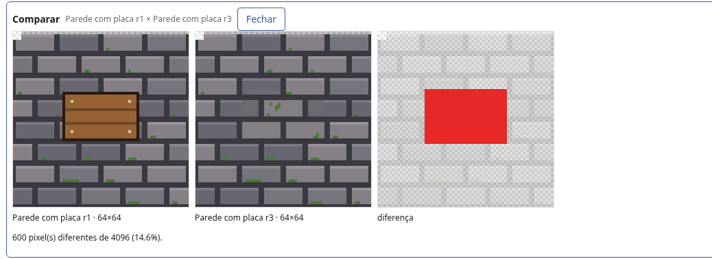
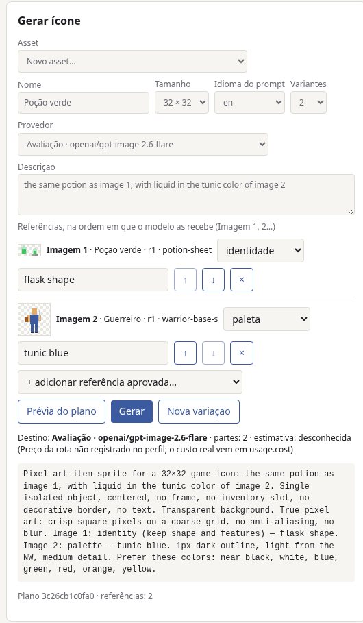
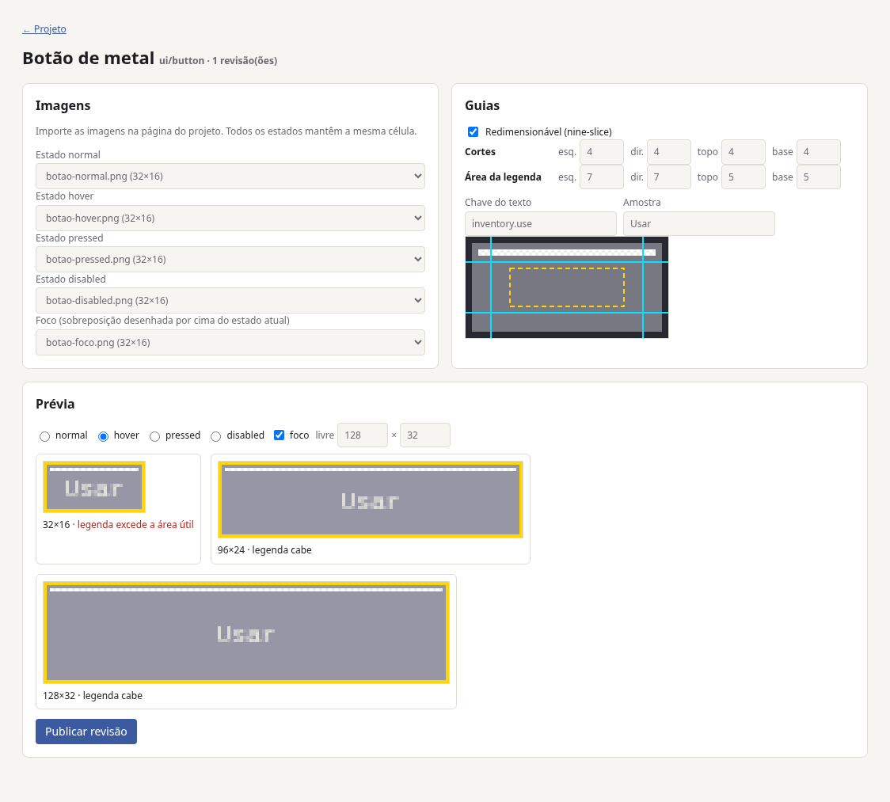
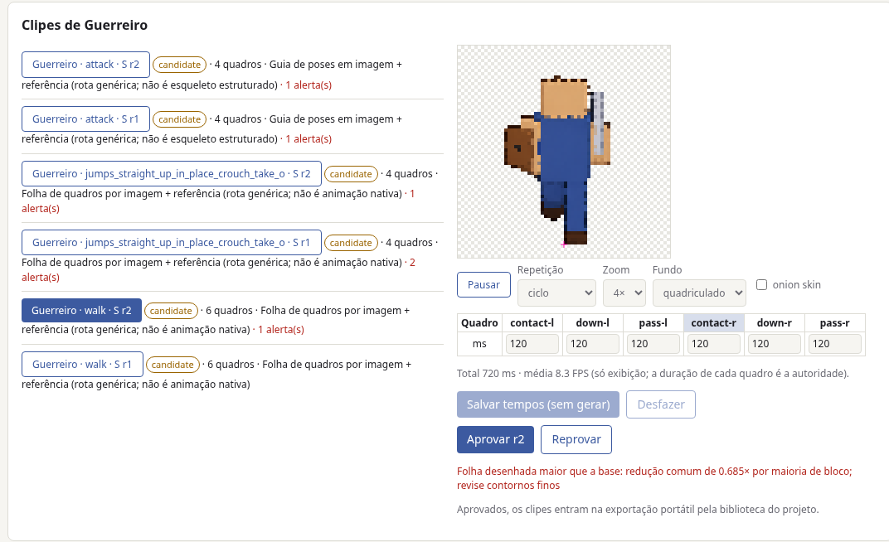
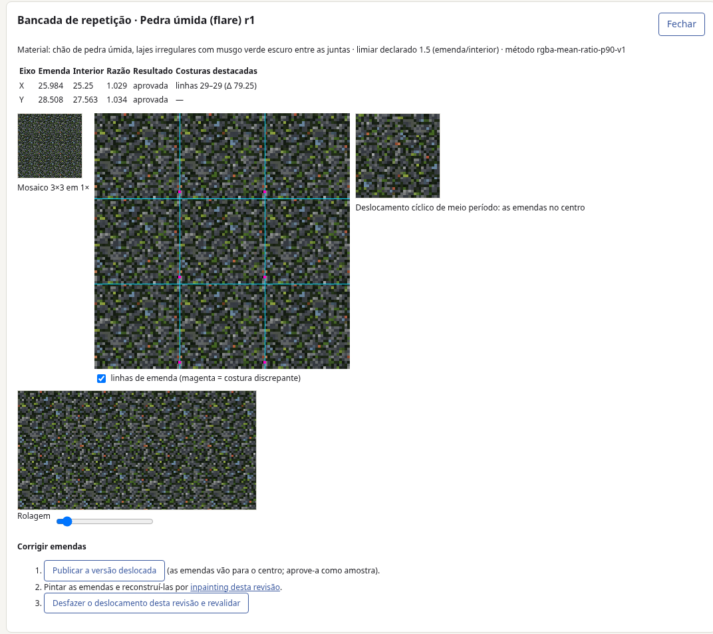
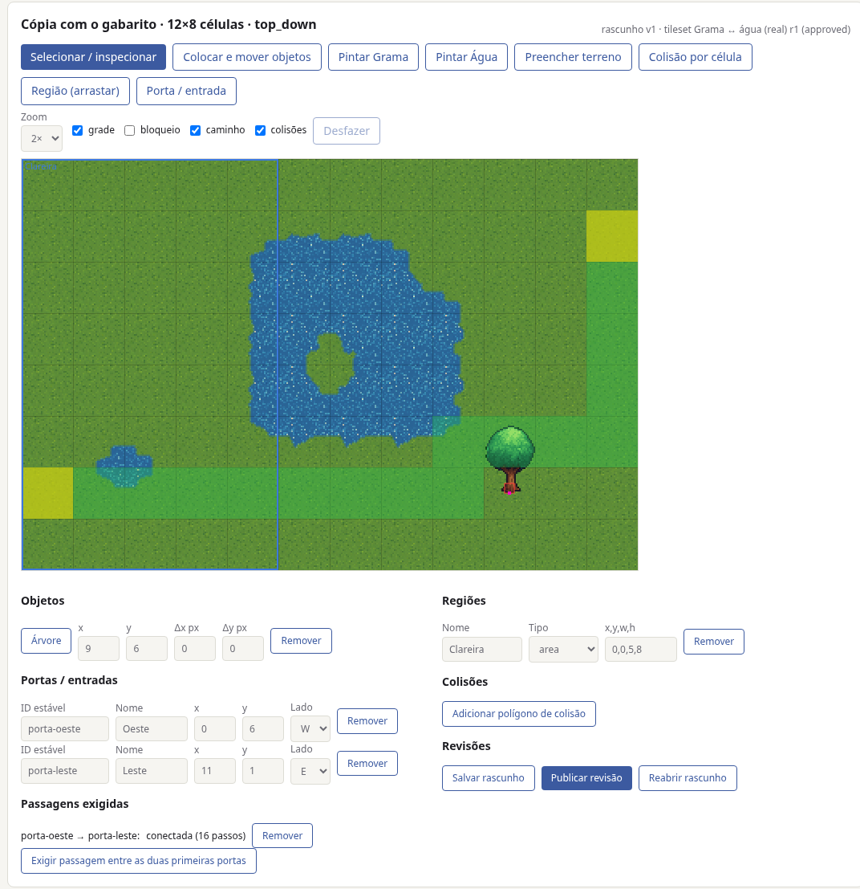

<h1 align="center">Pixel Studio</h1>

<p align="center">
  <strong>Open-source AI pixel art studio for game developers.</strong><br>
  Generate, edit, animate and export game-ready <b>sprites</b>, <b>item icons</b>, <b>sprite sheets</b>, <b>seamless textures</b>, <b>autotile tilesets</b>, <b>tile maps</b> and <b>game UI</b> with exact pixel-grid control. Works with any image model (GPT Image, Gemini, Seedream, FLUX and Qwen via OpenRouter), OpenAI Images or PixelLab.
</p>

<p align="center">
  <a href="LICENSE"></a>
  
  
  
  
  
</p>

<p align="center">
  
  <br><em>Inpainting a real model output: the sign is gone, bricks and moss continue, and the diff proves only the 600 masked pixels changed.</em>
</p>

---

## Why Pixel Studio?

General-purpose AI image models do not produce **real pixel art**. Ask for a "32×32 pixel art potion" and you typically get:

- a 1024×1024 image where each "pixel" is a fractional 36.6 px block, with anti-aliasing and blur;
- a fake checkerboard instead of transparency, or a soft semi-transparent halo;
- hex codes printed as text, plus frames and "inventory slot" borders nobody asked for;
- sprite-sheet frames that jitter, tiles that do not repeat, and edits that silently change the rest of the image.

Pixel Studio wraps any image model with a **deterministic pixel-art pipeline** and a **game asset catalog**. The pipeline:

1. recovers the model's apparent pixel grid;
2. removes chroma-key backgrounds by measured hue;
3. binarizes alpha and scales only by integer factors;
4. validates seams and mask protection numerically;
5. versions every result as a reviewable candidate;
6. exports everything as a portable, schema-validated package your game or engine can read.

It is **local-first and self-hosted**: a Next.js web app, a background worker, SQLite and content-addressed files on your disk. A built-in **simulated provider** lets you try every workflow **without API keys**.

## Features

### AI sprite and icon generation
- Text-to-sprite generation.
- **Ordered image references**, each with a role (identity, palette, style, pose...) and its own instruction.
- **Plan preview before any charge:** compiled prompt, provider, required capabilities and cost estimate. Budget caps block over-limit requests.
- **Idempotent, resumable jobs:** a double click never charges twice, and a crashed worker resumes by polling the provider instead of resubmitting.
- **Provider profiles with honest capabilities:** OpenRouter (any image model), OpenAI Images and PixelLab REST v2. A capability counts as "tested" only after a real run.

### Pixel-perfect post-processing (Python + Pillow)
- **Pixel grid detection ("unzoom"):** recovers art drawn on fractional cells at its native resolution.
- **Background removal:** chroma key by measured hue, plus flood fill with keep/remove brushes.
- **Alpha and scale:** alpha binarization, integer-only scaling, crop to content, fit to logical size.
- **Palette and sheets:** palette quantization with stable tie-breaking, grid slicing for sprite sheets, layer composition.

### Inpainting with exact RGBA protection
- Paint a mask, describe what should be there, and compare source, candidate and result.
- **Every pixel outside the mask keeps its original 4 RGBA bytes**, including RGB hidden under alpha 0. This is verified, not assumed.
- **Two explicit modes:**
  - **native mask:** PixelLab `/inpaint-v3`, OpenAI image edits;
  - **candidate + local composite:** any reference-capable model.

### Sprite animation
- **Modes:**
  - one-click presets (idle, walk, run, attacks, hurt);
  - free-text actions;
  - a **skeleton editor** with a keypoint timeline (18-joint humanoid);
  - **4/8-direction views** with isometric direction mapping.
- **No implicit mirroring:** a missing asymmetric direction is reported, never silently flipped.
- **Retime frames locally** without regenerating.

### Worlds: textures, tilesets and maps
- **Seamless texture generator** with numeric seam validation:
  - 3×3 mosaic, scroll preview and half-period shift;
  - discrepant seams highlighted;
  - one-axis tiling never promised as two-axis.
- **Corner-based autotile tilesets** (16 masks, Wang-style) with every compatible neighbor pair checked.
- **Side-scroller platform tilesets** with their own coverage table.
- **Isometric tiles and tall props** that keep their support point.
- **Tile map editor:**
  - paint terrain with autotiling;
  - place and move props;
  - collisions, regions and doors;
  - required walkable passages checked on publish;
  - reopen a map, or copy it with another tileset.

### Game UI
- **Nine-slice buttons and panels** with normal/hover/pressed/disabled states.
- **Focus overlay** and a separate text slot.
- Previews at several sizes (32×16, 96×24, custom).

### Asset management and export
- **Catalog:**
  - projects and a versioned **style guide** (palette, outline, light, detail);
  - revisions, plus review and approval with conflict detection;
  - lineage and a revision comparator with a pixel diff map.
- **Portable export:**
  - a ZIP with a **JSON manifest v1** and published **JSON Schemas**;
  - the dependency closure of approved revisions;
  - an independent Python reader, and re-import into another project.

## Screenshots

| Generate with ordered references (plan preview, no charge) | Game UI: nine-slice button editor |
|---|---|
|  |  |

| Sprite animation: walk cycle from a one-click preset | Seamless texture bench (3×3 mosaic, seam metrics) |
|---|---|
|  |  |

**Tile map editor:** a 12×8 map with corner autotiling, a lake, a tree prop, doors and a checked walkable passage.



> The interface is currently in **Brazilian Portuguese**. English localization is on the roadmap, and contributions are welcome.

## Quick start

**Requirements:**
- Node.js ≥ 24 (26 recommended, for the built-in `node:sqlite`);
- Python 3.14;
- [uv](https://docs.astral.sh/uv/).

```sh
git clone https://github.com/alanfrigo/pixel-studio.git
cd pixel-studio
npm install
npm run python:setup        # creates python/.venv with a pinned Pillow
cp .env.example .env        # optional: add OPENROUTER_API_KEY for real models
npm run dev                 # migrates the DB, starts web + worker
```

Open **http://127.0.0.1:3000**, create a project and generate your first sprite with the **Simulated** provider. No key and no cost are involved.

### Use real AI models

1. Put your key in `.env` (for example `OPENROUTER_API_KEY=...`). Profiles store only the **name** of the variable, never the secret.
2. Open **Settings** (`/settings`) and add a provider profile: transport, model and the env var name. Run the free check to discover routes, limits and prices.
3. Pick the profile when generating. [MODELS.md](MODELS.md) has benchmarked recommendations, for example:
   - `openai/gpt-image-1-mini` for cheap text-to-icon (~US$ 0.009);
   - `openai/gpt-image-2.6-flare` for references, inpainting and animation sheets.

## Examples

### Generate a 32×32 icon over the HTTP API

The API listens on loopback only, every mutation is validated, and every job is idempotent by key.

```sh
API=http://127.0.0.1:3000/api/v1
PROJECT=$(curl -s -X POST $API/projects -H 'content-type: application/json' \
  -d '{"name":"My RPG"}' | jq -r .project.id)
ASSET=$(curl -s -X POST $API/projects/$PROJECT/assets -H 'content-type: application/json' \
  -d '{"family":"item","kind":"consumable","name":"Green potion"}' | jq -r .asset.id)

# 1) Plan: validated, priced and frozen. Nothing is sent to any provider yet.
curl -s -X POST $API/projects/$PROJECT/generation-plans -H 'content-type: application/json' -d '{
  "operation": "generate_asset",
  "providerProfileId": "simulated",
  "brief": "green potion in a round glass flask with a cork stopper",
  "language": "en",
  "params": { "family": "item", "kind": "consumable", "logicalSize": [32, 32], "transparent": true, "variants": 2 }
}' > plan.json

# 2) Submit: the same idempotency key always returns the same job
jq --arg asset "$ASSET" '{kind:"generation", request:{plan:.plan, planDigest:.digest, targetAssetId:$asset}}' plan.json |
  curl -s -X POST $API/projects/$PROJECT/jobs -H 'content-type: application/json' \
       -H 'idempotency-key: potion-v1' -d @- | jq '.job | {id, state}'
```

The worker downloads each image, recovers the pixel grid, removes the background and fits it to 32×32. Each result becomes a **candidate revision** with a technical report: detected cell size, agreement, key hue and warnings.

### Inpainting

1. Upload a black-and-white mask PNG the same size as the source (255 = edit, 0 = protect).
2. Request a plan with `"operation": "inpaint"`, a `"mode"` of `"native-mask"` or `"candidate-composite"`, and an `instruction`.
3. Submit it as a job, as above.

An empty mask is rejected with zero provider calls. A full mask is reported as full regeneration.

### Export a portable package and read it anywhere

```sh
curl -s -X POST $API/projects/$PROJECT/exports -H 'content-type: application/json' \
  -d '{"revisionIds":["<approved revision ids>"]}'
# when ready: GET $API/projects/$PROJECT/exports/<exportId>/download → package.zip

python consumers/portable_reader/read_portable.py package.zip out/   # Pillow only, no Studio code
```

`manifest.json` lists every asset with logical sizes, pivots, frame durations, atlas rects, tileset rules and map layers. The JSON Schemas live in [`schemas/v1`](schemas/v1).

### Benchmark models yourself

```sh
npx tsx scripts/evaluate-models.ts                 # dry run: routes, prices, key limit
npx tsx scripts/evaluate-models.ts --yes --max-usd=3
```

## How it works


1. **Plan:** every AI operation (icon, inpaint, animation, view, texture, tileset) is compiled into a typed **generation plan**. The plan freezes hash-checked sources, required capabilities, parts and a cost estimate under a canonical digest.
2. **Queue:** the persistent job queue records the intent before each remote call, the remote ID on acceptance and the raw bytes on arrival. A crash between "sent" and "accepted" is flagged as *uncertain*, never silently resent.
3. **Process:** the Python pipeline runs pixel operations deterministically, and Node re-verifies hashes, paths and dimensions.
4. **Publish:** results become candidate revisions linked to their sources. Approval is explicit, and export resolves the runtime dependency closure.

## Supported providers

| Provider | Text-to-image | References | Native mask inpainting | Skeleton animation | Notes |
|---|---|---|---|---|---|
| **OpenRouter** (any image model) | ✅ | ✅ | via candidate + composite | via sprite sheet + pose guide | Benchmarked: GPT Image, Gemini, Seedream, FLUX, Qwen, MAI |
| **OpenAI Images** | ✅ | ✅ | ✅ (alpha mask) | — | contract-tested |
| **PixelLab REST v2** | ✅ | views only (`/rotate`) | ✅ `/inpaint-v3` | ✅ `/animate-with-skeleton-v3` | contract-tested; real trial pending |
| **Simulated** | ✅ | ✅ | ✅ | ✅ | offline and free, for development and demos |

Benchmarks, costs and per-task recommendations are in **[MODELS.md](MODELS.md)**.

## Project structure

```text
src/contracts/   versioned zod contracts (plans, manifest v1, assets, Python protocol)
src/domain/      pure rules: manifest validation, UI geometry, animation, autotile, isometric, maps
src/server/      catalog, job queue + worker handlers, provider adapters, inpainting, animation, world
src/app/         Next.js App Router: /api/v1 route handlers and the editors
src/worker/      background worker process
python/          pixel_pipeline (raster operations over a JSON stdio protocol) + pytest suite
consumers/       independent reader of the portable package (no Studio imports)
schemas/v1/      exported JSON Schemas for external tools
fixtures/        "Clareira" demo scene used by tests (characters, tileset, UI, audio, font)
scripts/         dev launcher, migrations, fixtures, benchmarks and real-model trials
```

## Development

```sh
npm run check            # typecheck + lint + Vitest + pytest
npm test                 # Vitest only
npm run test:python      # pytest only
npm run schemas:export   # regenerate schemas/v1 after changing a contract
npm run fixtures:build   # regenerate the deterministic fixture scene
```

Design rules the code follows:
- **Strict contracts:** unknown fields are rejected, and a new field means a new schema version.
- **Numbered SQL migrations** with checksums.
- **Secrets only in the server environment:** never in profiles, logs or the Python subprocess.
- **Honest capabilities:** a reference image is never presented as a native mask, nor a raster pose guide as a skeleton.

## Roadmap

- [x] Platform, contracts and portable export
- [x] Text and reference generation, background removal, palette, inpainting, nine-slice UI
- [x] Sprite animation: presets, text, skeleton, 4/8 views
- [x] Seamless textures, autotile tilesets, isometric props, tile map editor
- [ ] Equipment layering and modular characters (weapons, armor, sockets)
- [ ] Character states, frame interpolation and partial edits
- [ ] Scenes, rooms, parallax backgrounds and furniture kits
- [ ] UI kits: HUD, inventory, health bars, dialogue boxes
- [ ] Portraits, expressions, lip-sync and pixel fonts
- [ ] Music and sound effects
- [ ] Engine exports: Tiled (TMX/TMJ), Godot, Unity, Aseprite, GIF
- [ ] English UI localization
- [ ] Real trials of PixelLab native skeleton and tileset routes

## FAQ

**Can I use it without paying for an AI API?**
Yes. The simulated provider runs every workflow offline. You can also import your own art and use the local tools: background removal, palette, slicing, nine-slice, tilesets and maps.

**Does it produce real pixel art or just "pixel-art style" images?**
Real, grid-aligned pixel art at the logical size you ask for (16×16, 32×32, 64×64...). Every reduction step is recorded, and lossy steps are flagged.

**Which AI model is best for pixel art?**
It depends on the task. See [MODELS.md](MODELS.md) for real benchmarks with costs.

**Can I use the assets in commercial games?**
The software is MIT-licensed. The rights to the generated images depend on the terms of the AI provider you use.

## License

[MIT](LICENSE) © 2026 Alan Frigo
