<h1 align="center">Pixel Studio</h1>

<p align="center">
  <strong>Open-source AI pixel art studio for game developers.</strong><br>
  Generate, edit, animate and export game-ready <b>sprites</b>, <b>item icons</b>, <b>sprite sheets</b>, <b>seamless textures</b>, <b>autotile tilesets</b>, <b>tile maps</b> and <b>game UI</b> with exact pixel-grid control. Works with any image model (GPT Image, Gemini, Seedream, FLUX and Qwen via OpenRouter), OpenAI Images, or your local <b>Codex CLI</b> on a ChatGPT plan, with no API key.
</p>

<p align="center">
  <a href="LICENSE"></a>
  
  
  
  
  
</p>

<p align="center">
  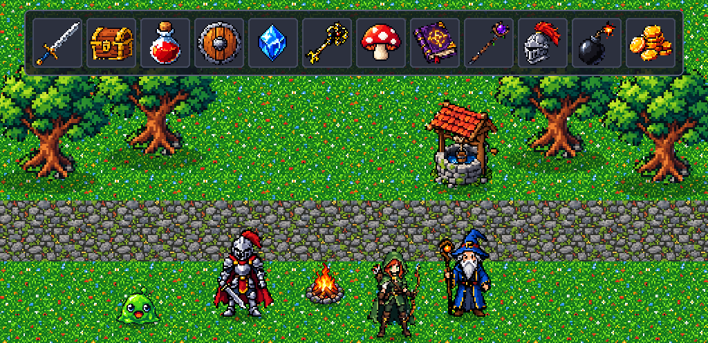
  <br><em>Every sprite, icon, prop and texture above was generated by AI through Pixel Studio and snapped to an exact pixel grid. The scene is a composition of those assets at integer scale, with no hand retouching.</em>
</p>

---

## Why Pixel Studio?

General-purpose AI image models do not produce **real pixel art**. Ask for a "32×32 pixel art potion" and you typically get:

- a 1024×1024 image where each "pixel" is a fractional 36.6 px block, with anti-aliasing and blur;
- a fake checkerboard instead of transparency, or a soft semi-transparent halo;
- hex codes printed as text, plus frames and "inventory slot" borders nobody asked for;
- sprite-sheet frames that jitter, tiles that do not repeat, and edits that silently change the rest of the image.

Pixel Studio wraps any image model with a **deterministic pixel-art pipeline** and a **game asset catalog**. The pipeline:

1. recovers the model's apparent pixel grid;
2. removes chroma-key backgrounds by measured hue;
3. binarizes alpha and scales only by integer factors;
4. validates seams and mask protection numerically;
5. versions every result as a reviewable candidate;
6. exports everything as a portable, schema-validated package your game or engine can read.

It is **local-first and self-hosted**: a Next.js web app, a background worker, SQLite and content-addressed files on your disk. A built-in **simulated provider** lets you try every workflow **without API keys**.

## Gallery: real AI output

Everything in this section was generated by an AI image model through Pixel Studio's own pipeline: `openai/gpt-image-2.6-flare` via OpenRouter, text prompts only, one attempt per image (the textures were redone once, at 64×64 instead of 32×32). **No hand retouching:** what you see is the published revision, scaled up by integer factors for display. The whole gallery cost **US$ 1.16** in billed API usage: US$ 1.10 for the images and US$ 0.06 for the inpainting edit. [Reproduce it](#reproduce-the-gallery).

### From model output to real pixel art

Image models paint "pixel art" as a 1024×1024 picture on a fractional grid. Pixel Studio detects that grid, recovers the art at its true resolution, removes the background and fits it to the logical size you asked for, flagging any lossy step.

<p align="center">
  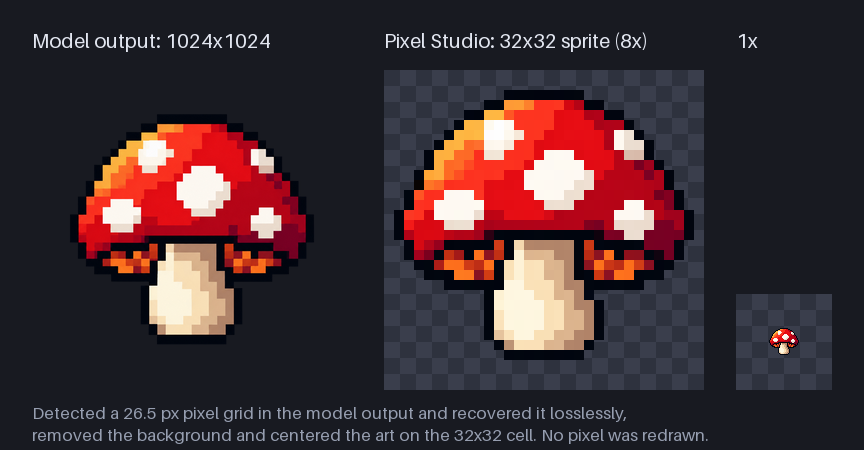
</p>

### Item icons (32×32, transparent)

<table>
  <tr>
    <td align="center" valign="top" width="25%">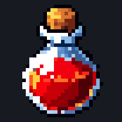<br><sub><i>“red health potion in a round glass flask with a cork stopper and a small highlight”</i><br>32×32 · <a href="docs/images/examples/potion-1x.png">1× PNG</a></sub></td>
    <td align="center" valign="top" width="25%">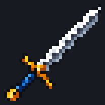<br><sub><i>“steel longsword with a golden crossguard and a blue leather grip, pointing up and to the right”</i><br>32×32 · <a href="docs/images/examples/sword-1x.png">1× PNG</a></sub></td>
    <td align="center" valign="top" width="25%">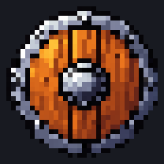<br><sub><i>“round wooden shield with an iron rim and a central iron boss”</i><br>32×32 · <a href="docs/images/examples/shield-1x.png">1× PNG</a></sub></td>
    <td align="center" valign="top" width="25%">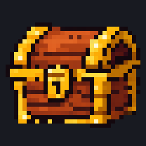<br><sub><i>“small wooden treasure chest with gold trim and a keyhole, closed”</i><br>32×32 · <a href="docs/images/examples/chest-1x.png">1× PNG</a></sub></td>
  </tr>
  <tr>
    <td align="center" valign="top" width="25%">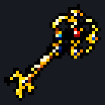<br><sub><i>“ornate golden key, diagonal”</i><br>32×32 · <a href="docs/images/examples/key-1x.png">1× PNG</a></sub></td>
    <td align="center" valign="top" width="25%">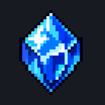<br><sub><i>“faceted blue crystal gem with a bright sparkle”</i><br>32×32 · <a href="docs/images/examples/gem-1x.png">1× PNG</a></sub></td>
    <td align="center" valign="top" width="25%">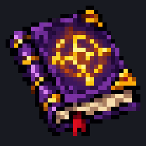<br><sub><i>“purple leather spell book with a glowing golden rune on the cover”</i><br>32×32 · <a href="docs/images/examples/spellbook-1x.png">1× PNG</a></sub></td>
    <td align="center" valign="top" width="25%">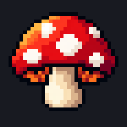<br><sub><i>“red mushroom with white spots and a pale stem”</i><br>32×32 · <a href="docs/images/examples/mushroom-1x.png">1× PNG</a></sub></td>
  </tr>
  <tr>
    <td align="center" valign="top" width="25%">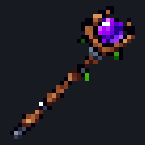<br><sub><i>“wooden magic staff topped with a glowing violet orb, diagonal”</i><br>32×32 · <a href="docs/images/examples/staff-1x.png">1× PNG</a></sub></td>
    <td align="center" valign="top" width="25%">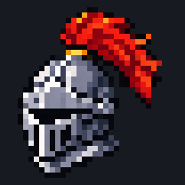<br><sub><i>“iron knight helmet with a visor slit and a red plume”</i><br>32×32 · <a href="docs/images/examples/helmet-1x.png">1× PNG</a></sub></td>
    <td align="center" valign="top" width="25%">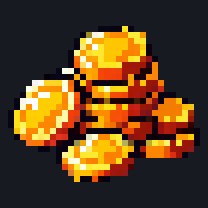<br><sub><i>“small pile of shiny gold coins”</i><br>32×32 · <a href="docs/images/examples/coins-1x.png">1× PNG</a></sub></td>
    <td align="center" valign="top" width="25%">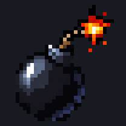<br><sub><i>“round black bomb with a lit fuse and a spark”</i><br>32×32 · <a href="docs/images/examples/bomb-1x.png">1× PNG</a></sub></td>
  </tr>
</table>

### Characters (64×64, transparent)

<table>
  <tr>
    <td align="center" valign="top" width="25%">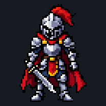<br><sub><i>“full body game character sprite of a knight in silver armor with a red cape and a sword, standing, front view facing the viewer”</i><br>64×64 · <a href="docs/images/examples/knight-1x.png">1× PNG</a></sub></td>
    <td align="center" valign="top" width="25%">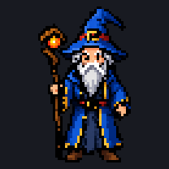<br><sub><i>“full body game character sprite of an old wizard in a blue robe and pointed hat holding a wooden staff, standing, front view”</i><br>64×64 · <a href="docs/images/examples/wizard-1x.png">1× PNG</a></sub></td>
    <td align="center" valign="top" width="25%">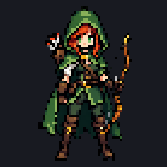<br><sub><i>“full body game character sprite of a female ranger in a green hooded cloak holding a bow, standing, front view”</i><br>64×64 · <a href="docs/images/examples/ranger-1x.png">1× PNG</a></sub></td>
    <td align="center" valign="top" width="25%">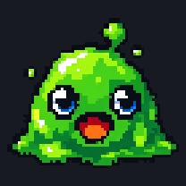<br><sub><i>“cute green slime monster with big eyes, game enemy sprite, front view”</i><br>64×64 · <a href="docs/images/examples/slime-1x.png">1× PNG</a></sub></td>
  </tr>
</table>

### Map props and seamless textures

<table>
  <tr>
    <td align="center" valign="top" width="33%">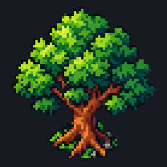<br><sub><i>“leafy oak tree with a thick brown trunk, top-down RPG map prop seen at three-quarter angle”</i><br>64×64 · <a href="docs/images/examples/oak-1x.png">1× PNG</a></sub></td>
    <td align="center" valign="top" width="33%">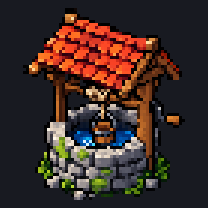<br><sub><i>“stone water well with a small wooden roof and a bucket, RPG map prop at three-quarter angle”</i><br>64×64 · <a href="docs/images/examples/well-1x.png">1× PNG</a></sub></td>
    <td align="center" valign="top" width="33%">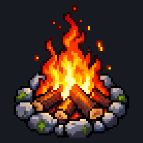<br><sub><i>“campfire with burning logs, orange flames and a ring of stones, RPG map prop”</i><br>64×64 · <a href="docs/images/examples/campfire-1x.png">1× PNG</a></sub></td>
  </tr>
</table>

<table>
  <tr>
    <td align="center" valign="top" width="33%">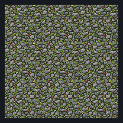<br><sub><i>“mossy grey cobblestone path”</i><br>64×64 tile, 3×3 mosaic · seams pass on X and Y · <a href="docs/images/examples/cobblestone-1x.png">1× PNG</a></sub></td>
    <td align="center" valign="top" width="33%">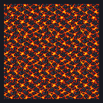<br><sub><i>“molten lava with dark cooled crust”</i><br>64×64 tile, 3×3 mosaic · seams pass on X and Y · <a href="docs/images/examples/lava-1x.png">1× PNG</a></sub></td>
    <td align="center" valign="top" width="33%">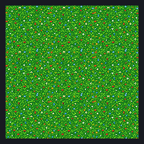<br><sub><i>“lush green meadow grass with tiny flowers”</i><br>64×64 tile, 3×3 mosaic · <b>Y seam rejected</b>: kept as a material sample, not marked tileable · <a href="docs/images/examples/grass-1x.png">1× PNG</a></sub></td>
  </tr>
</table>

The texture bench measures every seam numerically before a material may be marked tileable. The grass looks fine at a glance, but its vertical seam failed the profile test, so the Studio keeps it as a sample instead of promising a repeat it cannot deliver.

### Inpainting on generated art

Paint a mask over the cape, ask for "royal blue", and only the masked pixels change. The check below is computed independently on the RGBA bytes.

<p align="center">
  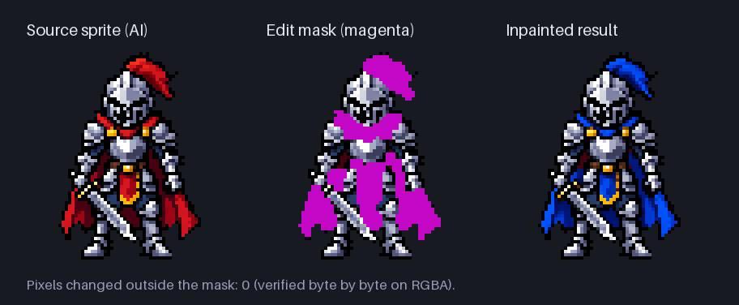
</p>

### From the feature trials: states, scenes and rooms

These come from the real-model trials of the newer features ([MODELS.md](MODELS.md) has every cost and failure), also generated through the Studio pipeline with `gpt-image-2.6-flare` and not retouched.

**Object state and animation.** A closed chest, its "open" state linked to it, and a 5-frame "open" clip with per-frame durations. No humanoid rig is needed.

<p align="center">
  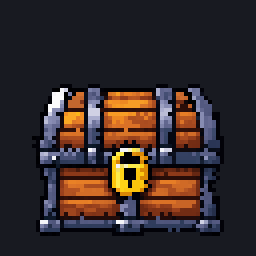
</p>

**Flat illustrated scene:** "bridge in a forest at sunset", 288×192. It is published as a flat image, so the trees are not claimed to be objects or collisions.

<p align="center">
  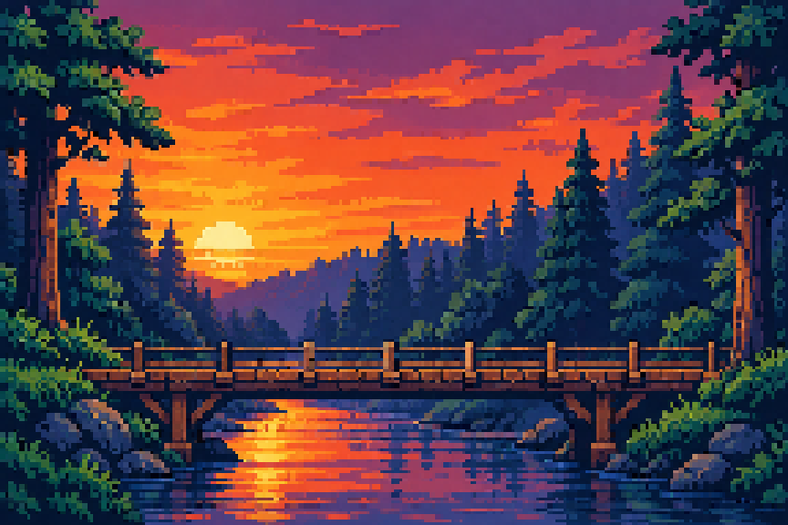
</p>

**Parallax background.** Sky and ground planes were generated separately, and each one passed the seam test on X. The Studio's camera test scrolls them at factors 0.15 and 1.0 across two background widths, checking for holes and for a continuous ground line. The GIF plays the camera back and forth.

<p align="center">
  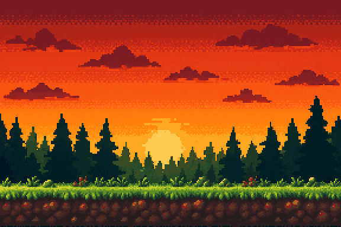
</p>

**Two rooms of one building**, generated from a 7×6 floor-plan guide with doors. The second room reuses the first one's style, and the two are linked door to door.

<p align="center">
  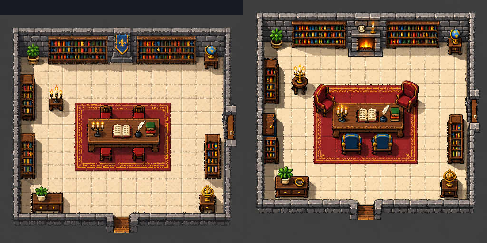
</p>

**Furniture extraction.** The table and chairs are cut out with a mask. The rug under them is rebuilt by inpainting, with 0 protected pixels changed. The table becomes a reusable prop with a support point, a footprint and a collision box.

<p align="center">
  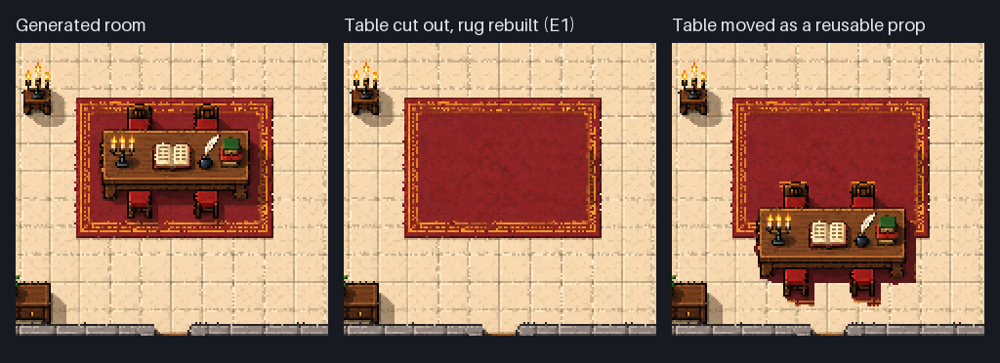
</p>

### Generated with a ChatGPT plan through the local Codex CLI

The same pipeline, driven by the [Codex CLI](https://github.com/openai/codex) installed on the machine, with no API key in Pixel Studio.
- Each image is one headless `codex exec` turn using Codex's built-in image tool, at about 45 s per image.
- The cost is one generation of the plan quota per image.
- 7 of 7 jobs succeeded on the first attempt, and the mana potion used the red potion as a style reference.
- The cape edit is an inpaint: **0 pixels changed outside the mask** (691 changed inside it), checked independently.

<p align="center">
  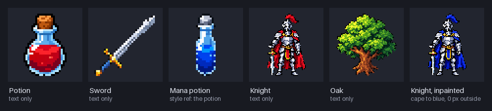
</p>

### Reproduce the gallery

```sh
npx tsx scripts/showcase-real.ts                      # dry run: route, cost estimate, key limit
npx tsx scripts/showcase-real.ts --max-usd=1.8 --yes  # 22 generations through the real job queue
npx tsx scripts/showcase-inpaint.ts --max-usd=0.2 --yes
python/.venv/bin/python -I scripts/showcase-compose.py reports/vitrine/<date>
python/.venv/bin/python -I scripts/showcase-features.py <date>   # states, scenes and rooms from the feature trials
npx tsx scripts/codex-real.ts --yes                                  # Codex CLI trial (7 images from your ChatGPT plan)
python/.venv/bin/python -I scripts/showcase-codex.py <date>
```

## Features

### AI sprite and icon generation
- Text-to-sprite generation.
- **Ordered image references**, each with a role (identity, palette, style, pose...) and its own instruction.
- **Plan preview before any charge:** compiled prompt, provider, required capabilities and cost estimate. Budget caps block over-limit requests.
- **Idempotent, resumable jobs:** a double click never charges twice, and a crashed worker resumes by polling the provider instead of resubmitting.
- **Provider profiles with honest capabilities:** OpenRouter (any image model), OpenAI Images and the local Codex CLI. A capability counts as "tested" only after a real run.

### Pixel-perfect post-processing (Python + Pillow)
- **Pixel grid detection ("unzoom"):** recovers art drawn on fractional cells at its native resolution.
- **Background removal:** chroma key by measured hue, plus flood fill with keep/remove brushes.
- **Alpha and scale:** alpha binarization, integer-only scaling, crop to content, fit to logical size.
- **Palette and sheets:** palette quantization with stable tie-breaking, grid slicing for sprite sheets, layer composition.

### Inpainting with exact RGBA protection
- Paint a mask, describe what should be there, and compare source, candidate and result.
- **Every pixel outside the mask keeps its original 4 RGBA bytes**, including RGB hidden under alpha 0. This is verified, not assumed.
- **Two explicit modes:**
  - **native mask:** OpenAI image edits;
  - **candidate + local composite:** any reference-capable model.

### Sprite animation
- **Modes:**
  - one-click presets (idle, walk, run, attacks, hurt);
  - free-text actions;
  - a **skeleton editor** with a keypoint timeline (18-joint humanoid);
  - **4/8-direction views** with isometric direction mapping.
- **No implicit mirroring:** a missing asymmetric direction is reported, never silently flipped.
- **Retime frames locally** without regenerating.

### Worlds: textures, tilesets and maps
- **Seamless texture generator** with numeric seam validation:
  - 3×3 mosaic, scroll preview and half-period shift;
  - discrepant seams highlighted;
  - one-axis tiling never promised as two-axis.
- **Corner-based autotile tilesets** (16 masks, Wang-style) with every compatible neighbor pair checked.
- **Side-scroller platform tilesets** with their own coverage table.
- **Isometric tiles and tall props** that keep their support point.
- **Tile map editor:**
  - paint terrain with autotiling;
  - place and move props;
  - collisions, regions and doors;
  - required walkable passages checked on publish;
  - reopen a map, or copy it with another tileset.

### Equipment layering and modular characters
- **Slots, anatomical sockets and stances:** a rig declares slots (main hand, off hand, torso...), hand sockets and stances such as `one_hand_shield` or `two_handed`.
- **Loadouts:** swap the short sword + shield for a longsword with the same armor. Conflicting slots are explained, with a one-click "replace". The stance follows from the pieces, and the resolved clip is pinned per action and direction.
- **Coverage matrix** of piece × clip × frame × part. A missing sleeve in one frame blocks only that combination, with a precise pointer (piece, direction, action, stance, frame), and an explicitly complete subset can still be exported.
- **Rigid weapons** reuse one approved view across frames, snapped grip-to-socket. A second hand drifting beyond the rig tolerance is flagged.
- **Draw order:** per-frame overrides, explicit empty cells, and a cell enlargement that shifts layers, sockets, pivot and coverage by the same margin.
- **"Create a piece for this character":** the plan shows the coverage matrix and strip count before any charge, can start from a proof pose, and generates only the gaps. On generic routes the model returns a dressed candidate and the piece is extracted locally with an explicit mask.
- **Free swaps:** after approval, switching loadouts, composing and exporting make zero provider calls. The flattened sheet is reproducible pixel by pixel from the exported layers.

### Character states, interpolation and partial edits
- **States** for characters and objects ("open", "wounded", "frozen"), linked to their origin, with a direction matrix. Approve only the views you like; rejected views become explicit gaps.
- **Objects without a humanoid rig:** chests, torches and similar props, with their own views, states and animations.
- **Frame interpolation** between two poses. In-betweens get new frame IDs and explicit durations, and the extremes are never duplicated.
- **Edit a span:** regenerate only the selected frames. Every other frame keeps its hash.
- **Fix one frame or region:** use a mask and the neighbor frames as context. The protected RGBA is restored, and the events and armor coverage that depend on that frame are listed.
- **Outfit transfer** produces a dressed candidate clip. It is never presented as a modular overlay, and it can feed the coverage extractor.
- **Library operations:** tags, duplicate, split directions, delete a part/direction/frame, explicit mirroring (blocked for asymmetric art without confirmation) and canvas resize. Packages exported earlier keep reproducing the same hashes.

### Scenes, rooms, parallax and furniture kits
- **Illustrated scenes:** describe composition, perspective, lighting and resolution, then review with a character overlaid at game scale. A flat image is never presented as an editable map.
- **Parallax backgrounds:** planes are generated or imported separately, each with an offset, per-axis factor and repeat. A camera test checks the loop, holes and the ground line.
- **Rooms:** a 7×6 floor-plan and door editor whose plan goes to the model as a raster guide, top-down, isometric or oblique views, and multi-room buildings with linked doors.
- **Furniture extraction:** areas that furniture used to cover are reviewed and rebuilt by inpainting, never by just erasing alpha. Each extracted piece becomes a reusable prop with support point, footprint, collision and shadow.
- **Room kits to editable maps:** walls, floors, corners and doors are cut from the room picture, mapped by key and rebuilt as a tile map in the world editor.
- **Isometric preview with a character** walking behind and in front of tall props, with world-to-screen direction mapping.

### Game UI kit: menus, HUD, inventory and dialogue
- **Nine-slice buttons and panels** with normal/hover/pressed/disabled/selected states, a focus overlay and a separate text slot. Captions are text keys, so translating or lengthening a label never regenerates the art.
- **Kit template from a brief:** the model draws the requested pieces into a guide grid, and you review the proposed crop of each piece before it becomes a component. Splitting crops pixels; it never invents new art.
- **States:** derived by image + reference of the approved component and checked for the same cell, outline and padding. Local transforms (palette ramp, highlight, offset) work without AI. Every state records its origin.
- **Components:**
  - menu items with action ID, shortcut and selected state;
  - health bars with separate track, fill and frame (0%, 25% and 100% keep the frame intact);
  - inventory slots in an integer grid, with linked item icons and quantity counters;
  - dialogue panels with separate title, body, portrait and continue indicator.
- **Screen composer:**
  - per-side anchors plus pixel offsets, groups, draw order and a separate keyboard focus order;
  - tested at 320×180 and 400×300 with integer zoom;
  - meter sliders, state toggles and caption swaps never start a generation job;
  - preview over an approved scene;
  - the exported package rebuilds the hierarchy and positions in a clean folder.

### Portraits, expressions, speech and pixel fonts
- **Portraits** generated from an approved character, with palette and scale checks and a face anchor.
- **Expressions and mouth shapes:** 8 visemes in the same order for every expression, with a face-stability check outside the mouth.
- **Speech timing plans:**
  - built locally from text (Portuguese and English letter rules) into a viseme, duration and text-position sequence;
  - two lines reuse the same approved mouths with zero new jobs;
  - a timing plan, not voice synthesis or audio sync.
- **Pixel fonts as assets:**
  - glyph pages drawn into a grid guide and measured locally into a bitmap atlas with baseline, bearings, advances and line height;
  - coverage is derived from the project's texts, and the Portuguese kit requires `á à â ã é ê í ó ô õ ú ü ç` in both cases;
  - missing glyphs are listed, never silently replaced, and can be extended from the approved base glyphs;
  - a test renderer shows "Ação, Poção, Coração — ÁRVORE" at 1× and zoom.

### English and Portuguese interface
- **Every screen in both languages,** with a language switch in the corner. The first visit follows the browser language.
- **Server text is bilingual too:** errors, route labels and technical-report warnings, including the ones from the Python pipeline. Data saved earlier keeps the language it was written in.

### Asset management and export
- **Catalog:**
  - projects and a versioned **style guide** (palette, outline, light, detail);
  - revisions, plus review and approval with conflict detection;
  - lineage and a revision comparator with a pixel diff map.
- **Portable export:**
  - a ZIP with a **JSON manifest v1** and published **JSON Schemas**;
  - the dependency closure of approved revisions;
  - an independent Python reader, and re-import into another project.

> The interface is currently in **Brazilian Portuguese**. English localization is on the roadmap, and contributions are welcome.

## Quick start

**Requirements:**
- Node.js ≥ 24 (26 recommended, for the built-in `node:sqlite`);
- Python 3.14;
- [uv](https://docs.astral.sh/uv/).

```sh
git clone https://github.com/alanfrigo/pixel-studio.git
cd pixel-studio
npm install
npm run python:setup        # creates python/.venv with a pinned Pillow
cp .env.example .env        # optional: add OPENROUTER_API_KEY for real models
npm run dev                 # migrates the DB, starts web + worker
```

Open **http://127.0.0.1:3000**, create a project and generate your first sprite with the **Simulated** provider. No key and no cost are involved. The interface is in English or Portuguese (switch in the top-right corner).

### Use real AI models

1. Put your key in `.env` (for example `OPENROUTER_API_KEY=...`). Profiles store only the **name** of the variable, never the secret.
2. Open **Settings** (`/settings`) and add a provider profile: transport, model and the env var name. Run the free check to discover routes, limits and prices.
3. Pick the profile when generating. [MODELS.md](MODELS.md) has benchmarked recommendations, for example:
   - `openai/gpt-image-1-mini` for cheap text-to-icon (~US$ 0.009);
   - `openai/gpt-image-2.6-flare` for references, inpainting and animation sheets.

### Use your ChatGPT plan through the Codex CLI

No API key needed: Pixel Studio can drive the [Codex CLI](https://github.com/openai/codex) installed on the same machine, which generates images with its built-in image tool on your ChatGPT plan.

```sh
npm install -g @openai/codex   # 0.144 or newer
codex login                    # sign in with ChatGPT once
```

In **Settings**, add a profile with the transport **Codex CLI local**. It takes no URL and no secret, and the model is optional. **Test without cost** checks the version, the login and the `imagegen` skill without starting a turn.

Each image is one headless `codex exec` turn with these properties:
- read-only sandbox, temporary working directory, `--ephemeral`;
- the Studio's own keys are stripped from the environment;
- the PNG is read byte for byte from the folder Codex creates for that session.

The cost is counted in **generations** of your plan quota, not dollars.

## Examples

### Generate a 32×32 icon over the HTTP API

The API listens on loopback only, every mutation is validated, and every job is idempotent by key.

```sh
API=http://127.0.0.1:3000/api/v1
PROJECT=$(curl -s -X POST $API/projects -H 'content-type: application/json' \
  -d '{"name":"My RPG"}' | jq -r .project.id)
ASSET=$(curl -s -X POST $API/projects/$PROJECT/assets -H 'content-type: application/json' \
  -d '{"family":"item","kind":"consumable","name":"Green potion"}' | jq -r .asset.id)

# 1) Plan: validated, priced and frozen. Nothing is sent to any provider yet.
curl -s -X POST $API/projects/$PROJECT/generation-plans -H 'content-type: application/json' -d '{
  "operation": "generate_asset",
  "providerProfileId": "simulated",
  "brief": "green potion in a round glass flask with a cork stopper",
  "language": "en",
  "params": { "family": "item", "kind": "consumable", "logicalSize": [32, 32], "transparent": true, "variants": 2 }
}' > plan.json

# 2) Submit: the same idempotency key always returns the same job
jq --arg asset "$ASSET" '{kind:"generation", request:{plan:.plan, planDigest:.digest, targetAssetId:$asset}}' plan.json |
  curl -s -X POST $API/projects/$PROJECT/jobs -H 'content-type: application/json' \
       -H 'idempotency-key: potion-v1' -d @- | jq '.job | {id, state}'
```

The worker downloads each image, recovers the pixel grid, removes the background and fits it to 32×32. Each result becomes a **candidate revision** with a technical report: detected cell size, agreement, key hue and warnings.

### Inpainting

1. Upload a black-and-white mask PNG the same size as the source (255 = edit, 0 = protect).
2. Request a plan with `"operation": "inpaint"`, a `"mode"` of `"native-mask"` or `"candidate-composite"`, and an `instruction`.
3. Submit it as a job, as above.

An empty mask is rejected with zero provider calls. A full mask is reported as full regeneration.

### Export a portable package and read it anywhere

```sh
curl -s -X POST $API/projects/$PROJECT/exports -H 'content-type: application/json' \
  -d '{"revisionIds":["<approved revision ids>"]}'
# when ready: GET $API/projects/$PROJECT/exports/<exportId>/download → package.zip

python consumers/portable_reader/read_portable.py package.zip out/   # Pillow only, no Studio code
```

`manifest.json` lists every asset with logical sizes, pivots, frame durations, atlas rects, tileset rules and map layers. The JSON Schemas live in [`schemas/v1`](schemas/v1).

### Benchmark models yourself

```sh
npx tsx scripts/evaluate-models.ts                 # dry run: routes, prices, key limit
npx tsx scripts/evaluate-models.ts --yes --max-usd=3
```

## How it works

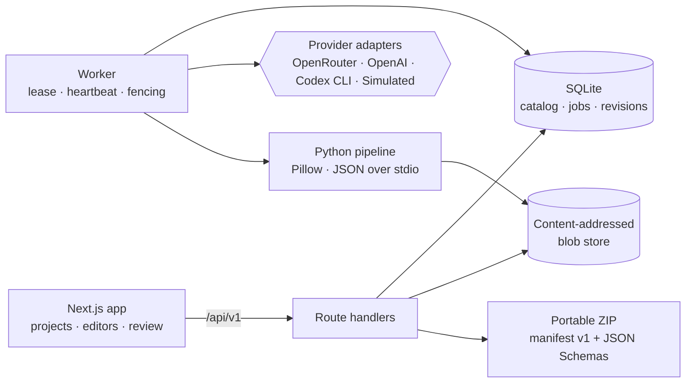

1. **Plan:** every AI operation (icon, inpaint, animation, view, state, interpolation, outfit coverage, texture, tileset, scene, room, furniture, UI template and states, portrait, mouth shapes, pixel font) is compiled into a typed **generation plan**. The plan freezes hash-checked sources, required capabilities, parts and a cost estimate under a canonical digest.
2. **Queue:** the persistent job queue records the intent before each remote call, the remote ID on acceptance and the raw bytes on arrival. A crash between "sent" and "accepted" is flagged as *uncertain*, never silently resent.
3. **Process:** the Python pipeline runs pixel operations deterministically, and Node re-verifies hashes, paths and dimensions.
4. **Publish:** results become candidate revisions linked to their sources. Approval is explicit, and export resolves the runtime dependency closure.

## Supported providers

| Provider | Text-to-image | References | Native mask inpainting | Skeleton animation | Notes |
|---|---|---|---|---|---|
| **OpenRouter** (any image model) | ✅ | ✅ | via candidate + composite | via sprite sheet + pose guide | Benchmarked: GPT Image, Gemini, Seedream, FLUX, Qwen, MAI |
| **OpenAI Images** | ✅ | ✅ | ✅ (alpha mask) | — | contract-tested |
| **Codex CLI** (local, `codex login`) | ✅ | ✅ up to 5 | via candidate + composite | via sprite sheet + pose guide | uses your ChatGPT plan, no API key in the Studio; one headless `codex exec` turn per image in a read-only sandbox |
| **Simulated** | ✅ | ✅ | ✅ | ✅ | offline and free, for development and demos |

Benchmarks, costs and per-task recommendations are in **[MODELS.md](MODELS.md)**.

## Project structure

```text
src/contracts/   versioned zod contracts (plans, manifest v1, assets, Python protocol)
src/domain/      pure rules: manifest validation, UI geometry and screens, animation, equipment, autotile, isometric, maps, scenes, dialogue and fonts
src/server/      catalog, job queue + worker handlers, provider adapters, inpainting, animation, equipment, library, world, scenes, UI kit, dialogue
src/app/         Next.js App Router: /api/v1 route handlers and the editors
src/i18n/        English and Portuguese message catalogs, locale negotiation, bilingual server text
src/worker/      background worker process
python/          pixel_pipeline (raster operations over a JSON stdio protocol) + pytest suite
consumers/       independent reader of the portable package (no Studio imports)
schemas/v1/      exported JSON Schemas for external tools
fixtures/        "Clareira" demo scene used by tests (characters, tileset, UI, audio, font)
scripts/         dev launcher, migrations, fixtures, benchmarks and real-model trials
```

## Development

```sh
npm run check            # typecheck + lint + Vitest + pytest
npm test                 # Vitest only
npm run test:python      # pytest only
npm run schemas:export   # regenerate schemas/v1 after changing a contract
npm run fixtures:build   # regenerate the deterministic fixture scene
```

Design rules the code follows:
- **Strict contracts:** unknown fields are rejected, and a new field means a new schema version.
- **Numbered SQL migrations** with checksums.
- **Secrets only in the server environment:** never in profiles, logs or the Python subprocess.
- **Honest capabilities:** a reference image is never presented as a native mask, nor a raster pose guide as a skeleton.

## Roadmap

- [x] Platform, contracts and portable export
- [x] Text and reference generation, background removal, palette, inpainting, nine-slice UI
- [x] Sprite animation: presets, text, skeleton, 4/8 views
- [x] Seamless textures, autotile tilesets, isometric props, tile map editor
- [x] Equipment layering and modular characters (weapons, armor, sockets)
- [x] Character states, frame interpolation and partial edits
- [x] Scenes, rooms, parallax backgrounds and furniture kits
- [x] UI kits: HUD, inventory, health bars, dialogue boxes
- [x] Portraits, expressions, speech timing plans and pixel fonts
- [ ] Music and sound effects
- [ ] Engine exports: Tiled (TMX/TMJ), Godot, Unity, Aseprite, GIF
- [x] English and Portuguese UI
- [x] Local Codex CLI provider (ChatGPT plan, no API key)

## FAQ

**Can I use it without paying for an AI API?**
Yes. The simulated provider runs every workflow offline. You can also import your own art and use the local tools: background removal, palette, slicing, nine-slice, tilesets and maps.

**Does it produce real pixel art or just "pixel-art style" images?**
Real, grid-aligned pixel art at the logical size you ask for (16×16, 32×32, 64×64...). Every reduction step is recorded, and lossy steps are flagged.

**Which AI model is best for pixel art?**
It depends on the task. See [MODELS.md](MODELS.md) for real benchmarks with costs.

**Can I use the assets in commercial games?**
The software is MIT-licensed. The rights to the generated images depend on the terms of the AI provider you use.

## License

[MIT](LICENSE) © 2026 Alan Frigo
